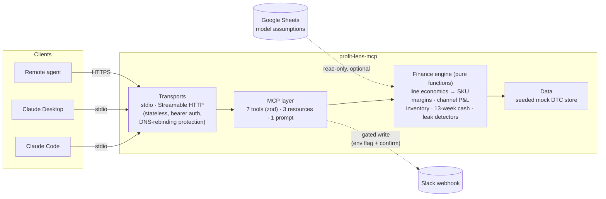

# profit-lens-mcp

[](https://github.com/AlanEinsteinS/profit-lens-mcp/actions/workflows/ci.yml)


**An MCP server that gives Claude a fractional CFO's toolkit for DTC ecommerce brands.**

Ask *"where are we losing money?"* and the agent gets back real unit economics, not dashboards: contribution margin per SKU after every cost, channel P&L with breakeven and marginal ROAS, a 13-week cash forecast, reorder alerts, and a ranked list of profit leaks with the evidence and the fix. It runs on a realistic mock store out of the box (zero credentials), with optional Google Sheets and Slack integrations behind env vars.

```text
> Where are we leaking profit this month?

● profit-lens - find_profit_leaks (MCP)
  ⎿ Found 7 leak(s) worth about $43,686/month. Biggest: TikTok Ads spend up 205% but the
    extra budget returns 0.53x (breakeven 1.91x) ($11,094/month).

Seven leaks, about $43.7k/month. The top three:

1. TikTok overspend, $11.1k/mo. Spend tripled in the last 28 days, but each extra dollar
   returned $0.53 in revenue; at TikTok's margins it needs $1.91 just to break even. The
   blended 1.35x ROAS hides this because it averages the profitable base budget with the new spend.
   Fix: roll back toward ~$284/day and scale only with tests that clear breakeven.
2. Candle Gift Set stockout, $9.5k/mo. It runs out on Dec 9, about 11 days before stock
   can land, right in the gifting peak. Fix: order ~1,530 units now with expedited freight.
3. Leaked code FRIENDS40, $8.2k/mo. A 40% code jumped from a handful of orders to 7.4% of
   all orders (44x), the usual sign that it's on coupon sites. Fix: expire or cap it.
```

## Why this exists

DTC brands usually manage by ROAS and revenue, and both can look healthy while the business loses money: a heavy product whose free shipping eats its margin, a channel whose *incremental* spend is unprofitable, a discount code that leaked. Finding these needs every cost allocated down to the order line, which is exactly the kind of tedious, precise work an agent should delegate to tools instead of doing in its head.

profit-lens does the math deterministically in TypeScript and gives the model compact, explained results. The model does what it is good at: asking the right questions, connecting findings, and writing the memo.

## What's inside

| Tool | What it answers |
|---|---|
| `get_store_overview` | What data is there? Date range, catalog, last-30-day headline. Start here. |
| `get_sku_margins` | Which products make money after COGS, shipping subsidy, 3PL, payment fees and allocated ads (CM1 / CM2 / CM3, totals, % and per unit). |
| `get_channel_pnl` | P&L per channel: orders, new customers, CM2, ad spend, CM3, AOV, ROAS, **breakeven ROAS**, CAC; store MER and change vs the previous period. |
| `forecast_cash_13_weeks` | Direct-method weekly cash forecast with a day-by-day inventory simulation (open POs, simulated reorders, stockouts). What-if on ad spend and growth. |
| `get_inventory_reorder_alerts` | Days of cover, stockout date, reorder point, inbound POs, recommended order qty rounded to case pack and MOQ. |
| `find_profit_leaks` | Six detectors ranked by monthly profit impact, each with evidence, a plain-English explanation and an action. |
| `post_weekly_digest_to_slack` | The only write. Dry-run by default; see [Safety](#safety). |

**Resources:** `profit-lens://assumptions` (model assumptions and their source), `profit-lens://schema` (entities and exact metric definitions), `profit-lens://catalog` (products, stock, open POs).

**Prompt:** `weekly-profit-review` (args: `audience` = founder | cfo | ops, optional `focus`) runs the full review in a fixed order and writes a memo that cites which tool each number came from.

**Leak detectors:** unprofitable SKU after ads, refund-rate outlier (on a matured window, since refunds lag), channel overspend (marginal ROAS below breakeven), leaked discount code (deep, surging and dilutive), stockout risk (lost contribution), dead stock (holding cost of the excess).

## Quickstart

Requires Node.js 20+.

```bash
git clone https://github.com/AlanEinsteinS/profit-lens-mcp.git
cd profit-lens-mcp
npm ci
npm run build
```

### Claude Code

The repo ships a project-scoped `.mcp.json`, so opening Claude Code in the folder is enough (approve the server when asked):

```json
{
  "mcpServers": {
    "profit-lens": {
      "command": "node",
      "args": ["dist/src/index.js"]
    }
  }
}
```

To use it from any project instead:

```bash
claude mcp add profit-lens -- node /absolute/path/to/profit-lens-mcp/dist/src/index.js
```

Then try: *"Run the weekly-profit-review prompt for the CFO"*, *"Which SKUs lose money after ads?"* or *"What happens to cash if we cut ad spend 20%?"*

### Claude Desktop

Add to `claude_desktop_config.json` (macOS: `~/Library/Application Support/Claude/`, Windows: `%APPDATA%\Claude\`) and restart:

```json
{
  "mcpServers": {
    "profit-lens": {
      "command": "node",
      "args": ["/absolute/path/to/profit-lens-mcp/dist/src/index.js"]
    }
  }
}
```

### Remote: Streamable HTTP + Docker

```bash
cp .env.example .env          # set MCP_HTTP_TOKEN at least
docker compose up -d --build  # binds 127.0.0.1:3000; put your reverse proxy with TLS in front
curl http://127.0.0.1:3000/health
claude mcp add --transport http profit-lens http://127.0.0.1:3000/mcp \
  --header "Authorization: Bearer $MCP_HTTP_TOKEN"
```

Without Docker: `npm run start:http`.

## Architecture



- **One source of truth for costs.** Every order cost is allocated down to the order line once (`src/finance/economics.ts`): shipping subsidy by weight, 3PL by units, payment fees by revenue. SKU margins, channel P&L and leak detection are just different groupings of those rows, so they reconcile with each other (there is a test for that).
- **Pure finance core.** `src/finance` has no I/O and no MCP imports. It is unit tested against hand-computed fixtures and can be reused outside MCP.
- **Thin MCP layer.** `src/tools.ts` validates input with zod, picks a date range, calls the engine, rounds money to cents at the boundary, and returns a one-line `summary` plus the data as both JSON text and `structuredContent`.

## The demo store

`Alder & Ash` is a fictional home-goods brand (about $350k net revenue per month, 12 SKUs, 5 channels, 180 days of history) generated from a fixed seed, so every run, test and README number is reproducible. It has daily seasonality, a growth trend, new vs returning customers, discount codes, refunds that land days after the order, carrier oversize surcharges, 3PL fees, two payment gateways and ad spend with diminishing returns.

A few realistic problems are planted (listed in `SCENARIO` in `src/data/generator.ts`): an oversized planter whose shipping eats its margin, a duvet with a 16% refund rate, a TikTok budget tripled into diminishing returns, a 40% code that leaked to coupon sites, two Q4 stockouts and an overstocked rug. **The detectors never read those flags**; they find the problems from the raw numbers, and the evals check that they find all of them with no false positives.

## Design decisions

- **Deterministic math in code, judgment in the model.** LLMs are bad at summing 22,000 orders; tools return finished numbers with the formula in the explanation, so the model can reason about them and cite them.
- **Answers, not tables.** Each result starts with a `summary` sentence and leaks come with evidence and an action, which keeps context small and makes the agent's first answer useful.
- **Marginal, not average.** Channel overspend compares the change in revenue to the change in spend against the channel's breakeven ROAS. Average ROAS would have called TikTok fine.
- **Cash is a simulation, not a ratio.** The forecast walks each SKU day by day: open POs land and are paid on arrival, reorders fire at the reorder point (deposit now, balance on arrival), and stockouts reduce cash in.
- **Stateless HTTP.** A fresh `McpServer` per request over a shared read-only context: nothing to lose on restart, scales horizontally.
- **Assumptions live where finance people keep them.** Opening cash, opex, buffers and inventory policy can come from a Google Sheet; the `assumptions` resource always says which source is in use.
- **Rounding once, at the edge.** The engine works at full precision; outputs are rounded to cents in one place.

## Safety

- **Read-only by default.** Six of seven tools are annotated `readOnlyHint: true` and have no side effects.
- **Gated writes.** `post_weekly_digest_to_slack` returns a dry-run preview unless the server runs with `PROFIT_LENS_ENABLE_SLACK_WRITES=true` *and* a `SLACK_WEBHOOK_URL`, and even then it only posts when called with `confirm: true`. The tool description tells the model to show the preview and get the user's OK first.
- **No SSRF via config.** The Slack client refuses any URL that is not `https://hooks.slack.com/...`, and errors never echo the webhook (it is a secret).
- **No mass pings.** User text in the digest is escaped, so `<!channel>` or fake links cannot be injected into Slack.
- **Secrets only from env.** Nothing sensitive is read from the repo; `.env` and key files are git-ignored. Google access uses the read-only Sheets scope.
- **HTTP hardening.** Optional bearer token (constant-time compare), Host header validation against DNS rebinding, a warning when binding to a public interface without a token. The container runs as a non-root user with a read-only filesystem and no capabilities.
- **Validated input.** Every argument is checked by zod; dates outside the data and unknown SKUs return a clear tool error the model can recover from.

## Testing and evals

```bash
npm run typecheck   # strict TypeScript (noUncheckedIndexedAccess, exactOptionalPropertyTypes)
npm run lint        # ESLint with typescript-eslint strict-type-checked
npm test            # 76 Vitest tests: finance math vs hand-computed fixtures, MCP in-memory and HTTP
npm run eval        # 13 golden scenarios through a real MCP client
npm run check       # all of the above
```

The evals (`evals/run.ts`) call the tools the way an agent does and check the answers a finance lead would expect: every planted problem found and nothing healthy flagged, totals match golden values, the forecast reconciles week by week, an ad-spend scenario moves spend by exactly the requested share, writes stay dry-run, and bad input gets a useful error.

CI runs all of it on Node 20, 22 and 24, then builds the Docker image, waits for the health check and calls a tool over HTTP.

## Configuration

Everything is optional. See [.env.example](.env.example).

| Variable | Default | Purpose |
|---|---|---|
| `MCP_TRANSPORT` | `stdio` | `stdio` or `http` (or `--transport http`) |
| `HOST` / `PORT` | `127.0.0.1` / `3000` | HTTP bind address |
| `MCP_HTTP_TOKEN` | | Require `Authorization: Bearer <token>` on `/mcp` |
| `MCP_ALLOWED_HOSTS` | | Host header allow-list (comma-separated) |
| `PROFIT_LENS_SEED` / `PROFIT_LENS_AS_OF` | `42` / `2026-11-15` | Mock data seed and last day of data |
| `GOOGLE_SHEETS_ID` / `GOOGLE_SHEETS_RANGE` | / `Assumptions!A:B` | Load assumptions from a two-column label/value range |
| `GOOGLE_SERVICE_ACCOUNT_JSON` | | Service-account JSON (or use `GOOGLE_APPLICATION_CREDENTIALS`) |
| `SLACK_WEBHOOK_URL` | | Incoming webhook for the digest |
| `PROFIT_LENS_ENABLE_SLACK_WRITES` | `false` | Allow real posts (still requires `confirm: true`) |

## Project layout

```text
src/
  index.ts            entry point: picks stdio or HTTP
  server.ts           builds the McpServer (instructions, tools, resources, prompt)
  tools.ts            tool definitions, zod schemas, result formatting
  resources.ts        assumptions, schema and catalog resources
  prompts.ts          weekly-profit-review prompt
  http.ts             Streamable HTTP app: health, auth, stateless handler
  config.ts           env parsing (zod)
  context.ts          dataset + assumptions + Slack sink shared by all sessions
  data/               seeded generator, PRNG, domain types
  finance/            pure unit-economics engine
  integrations/       Google Sheets (read) and Slack (write) clients
test/                 Vitest suites
evals/                golden scenarios
```

## Roadmap

- Live data sources behind the same interface: Shopify Admin API (orders, refunds), Meta and Google Ads spend, a 3PL invoice import.
- Cohort LTV and payback period per channel.
- An LLM-in-the-loop eval that runs the `weekly-profit-review` prompt and grades the memo against the tool outputs.

## License

[MIT](LICENSE)
